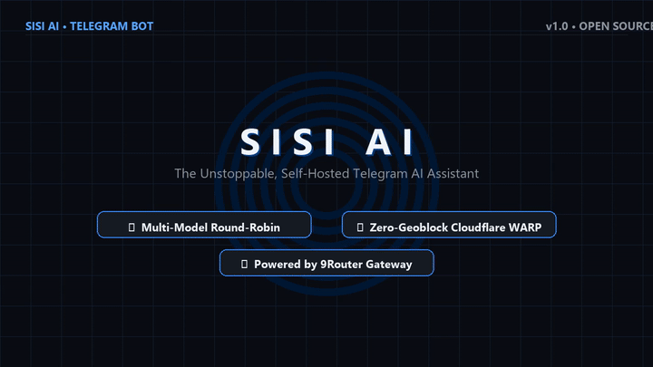
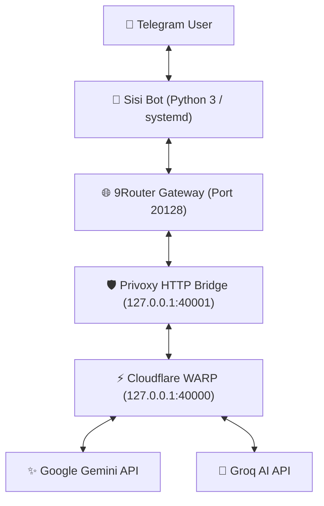

# 🤖 Sisi Telegram AI Bot & 9Router Gateway Stack

<p align="center">
  
</p>

<p align="center">
  <a href="https://www.python.org/"></a>
  <a href="https://core.telegram.org/bots/api"></a>
  <a href="https://github.com/9router/9router"></a>
  <a href="https://developers.cloudflare.com/warp-client/"></a>
  <a href="https://github.com/XTLS/Xray-core"></a>
  <a href="./LICENSE"></a>
</p>

---

## 💡 Overview

**Sisi** is a production-grade, self-hosted Telegram AI chatbot powered by the **9Router AI Gateway**. It seamlessly balances requests across multiple **Google Gemini** and **Groq AI** keys, solves regional geo-restrictions via an automatic **Cloudflare WARP** tunnel, supports native spoken audio generation (neural TTS), voice note transcription (Whisper Large v3), live internet searches, and includes an optional personal **VLESS Reality** proxy to bypass strict DPI censorship.

---

## 🏗️ Architecture



---

## ✨ Key Features

- **🔄 Multi-Key Round-Robin Balancing:**
  - **Google Gemini:** Automated load-balancing and failover with 1,000,000+ token context window.
  - **Groq AI:** Ultra-fast completions (`qwen/qwen3.8-27b`, `openai/gpt-oss-120b`) and Whisper STT with automatic key rotation.
- **🛡️ 100% Geo-Unblocking & Cloudflare Bypass:**
  - Integrated Cloudflare WARP proxy (`mode proxy` on `40000`) and Privoxy bridge (`40001`) eliminates `400: User location is not supported` on Gemini and Cloudflare `1010` blocks on Groq.
- **🎙️ Neural Voice Intelligence:**
  - **Speech-to-Text (STT):** Voice notes sent to the bot are transcribed in real-time via Groq Whisper Large v3.
  - **Text-to-Speech (TTS):** Responses can be converted to high-fidelity neural voice notes via Microsoft Edge-TTS (`fa-IR-DilaraNeural` & `en-US-AvaNeural`).
  - **Toggle Mode:** Use `/voice on` to hear spoken audio replies for every message.
- **🧠 Multi-Turn Memory & Personas:**
  - Configurable system prompts via `.env` with multi-turn sliding window memory.
- **🔍 Live Web Search:**
  - Type `/search <query>` to search the live web via DuckDuckGo and synthesize a cited answer.
- **🚀 Built-in VLESS Reality Proxy:**
  - One-click script to deploy an Xray VLESS + TCP + Reality proxy on port 443 with TLS masquerading (`speedtest.net`) to defeat DPI blocking.

---

## 🚀 1-Click Quickstart on Any Clean VPS

Deploy the complete stack on any clean **Ubuntu 20.04, 22.04, or 24.04 LTS** VPS in under 2 minutes:

### 1. Clone Repository
```bash
git clone https://github.com/TheBanith/sisi-bot.git
cd sisi-bot
```

### 2. Configure Environment
```bash
cp .env.example .env
nano .env
```
Fill in your `TELEGRAM_BOT_TOKEN`, `GEMINI_API_KEYS`, and `GROQ_API_KEYS`.

### 3. Run Automated Installer
```bash
sudo bash install.sh
```

The installer automatically:
1. Allocates a 2GB swap space to prevent memory issues on 1GB VPSs.
2. Installs Node.js 20 LTS, Cloudflare WARP, Privoxy, and ffmpeg.
3. Installs and configures 9Router and its SQLite native runtime.
4. Creates a Python virtual environment and installs dependencies.
5. Populates all API keys, round-robin rules, and smart combos in 9Router.
6. Starts and enables `9router.service` and `sisi-bot.service`.

---

## 🛡️ Optional: Setup Personal VLESS Reality Proxy

If you want a personal anti-censorship proxy on the same server:
```bash
sudo bash scripts/setup_xray.sh
```
This instantly generates an importable `vless://` link compatible with **v2rayNG, Streisand, v2rayN, and Hiddify**.

---

## 💬 Bot Commands

| Command | Description |
| :--- | :--- |
| `/start` | Welcome greeting and feature summary |
| `/voice on` | Enable spoken voice replies for all messages |
| `/voice off` | Speak only when receiving voice notes |
| `/voice` | Check or toggle voice response mode |
| `/search <query>` | Live internet search with AI synthesis |
| `/model` | Inspect active model and available options |
| `/model <name>` | Switch active model (e.g., `/model sisi` or `/model gemini/gemini-3.8-flash`) |
| `/reset` | Clear conversation memory and start fresh |
| *Send Voice Note* | Automatic Whisper speech transcription & voice response |

---

## 🛠️ Service Management

```bash
# Sisi Telegram Bot
sudo systemctl status sisi-bot
sudo journalctl -f -u sisi-bot

# 9Router AI Gateway
sudo systemctl status 9router
sudo journalctl -f -u 9router

# Cloudflare WARP & Privoxy
sudo systemctl status warp-svc
sudo systemctl status privoxy

# Restart All Services
sudo systemctl restart sisi-bot 9router warp-svc privoxy
```

---

## 🌐 9Router Web Dashboard
- **URL:** `http://<YOUR_VPS_IP>:20128/dashboard`
- **Default Password:** Defined in `.env` (`NINE_ROUTER_PASSWORD`)

---

## 📄 License
This project is open-source under the [MIT License](./LICENSE).
